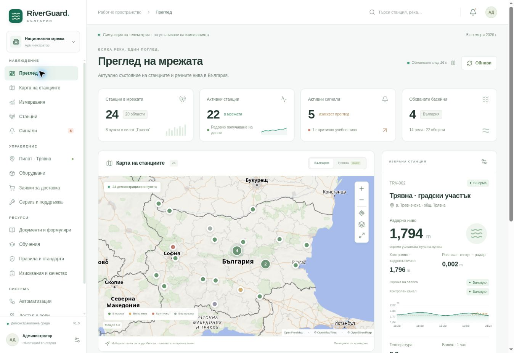

# RiverGuard България

Работещ прототип за уточняване на изискванията към национална система за речен мониторинг с пилот за община Трявна. Съдържа интерактивна карта, измервания и експорт, общински права, сигнали, вътрешни заявки за оборудване, сервизни задачи, съгласуване на местоположения, документи, обучения и проследимост на изискванията.

**Състояние:** демонстрационна среда с постоянна база данни; достъпът до хоствания сайт е частен, само за собственика. Примерните станции, прагове и местоположения не са одобрена национална мрежа или система за официално предупреждение. Няма изпратени поръчки, плащания, съобщения до институции, разрешен монтаж или производствена сертификация.

## Архитектура

| Част | Реализация и местоположение |
| --- | --- |
| Интерфейс | React 19 и Vinext; `app/components/`, `app/page.tsx` |
| Карта | OpenLayers (Canvas 2D) с картографска основа OpenFreeMap; атрибуцията към данните остава видима |
| API | Vinext маршрути в `app/api/[...path]/route.ts`; операции и права в `lib/server.ts` |
| Домейн | Валидация, общински обхват, симулация и експорт в `lib/domain.mjs` |
| Изпълнение | Cloudflare Worker; `worker/index.ts`, Vite и Sites конфигурация |
| Съхранение | Cloudflare D1, свързана като `DB`; SQLite схема в `db/schema.ts`, миграции в `drizzle/` |
| Съдържание | `lib/seed.ts`, `lib/sensors-content.json`, `lib/legal-content.json` |
| Проверки | `tests/domain.test.mjs`, `tests/api.test.mjs`, `.github/workflows/ci.yml` |

Регистърът, потребителските роли, настройките, заявките, сервизните задачи, сигналите, съгласуванията, оценките за качество и завършените обучения се записват в D1. Картата изисква достъп до външния доставчик; изобразяването използва Canvas 2D и не изисква WebGL; справката за измерванията е отделна от картографската основа.

## Инсталация и локално стартиране

Необходими са Node.js 22, поне 22.13.0, и **pnpm 11.25.0**, съгласно `package.json`. Командите се изпълняват от корена на проекта. Не стартирайте едновременно две инсталации.

```sh
pnpm install --frozen-lockfile
pnpm build
```

Компилирането създава `dist/server/wrangler.json`. За **нова локална база** приложете началната миграция:

```sh
node --import ./scripts/sites-env.mjs ./node_modules/wrangler/bin/wrangler.js d1 execute DB --local --config dist/server/wrangler.json --persist-to .wrangler/state --file drizzle/0000_wonderful_turbo.sql
```

След това стартирайте средата за разработка:

```sh
pnpm dev
```

При обичайното локално изпълнение портът е 5173; използвайте адреса от терминала. Първото успешно зареждане на API създава началните 24 демонстрационни станции и работни записи. Локалната база е отделна от хостваната.

В локалния профил `portable` е налична симулация на вход през `/signin-with-chatgpt?return_to=/`, само при разработка през локалния адрес. Без платформена самоличност непроизводствената среда използва локален демонстрационен собственик. Хостваната среда изисква действителен вход. За преглед на вече компилирания Worker използвайте `pnpm start`; тази команда не публикува и не симулира вход. При работа през управляваната среда на Sites се използват нейните помощни команди и върнатият адрес за преглед.

### Промени по базата

След промяна на `db/schema.ts` изпълнете `pnpm db:generate`, прегледайте получения SQL и приложете всяка **нова** миграция по ред. Не редактирайте вече приложена миграция и не изпълнявайте повторно началния SQL върху съществуваща база. Всички локални инструменти използват `.wrangler/state`. Производствените миграции се прилагат отделно чрез процеса за публикуване на Sites.

`dist/`, `.wrangler/`, `.vinext/`, `.sites-runtime/`, `.env*` и `.dev.vars*` са локални или генерирани файлове и не са част от изходния код за споделяне.

## Идентичност и права

Хостинг платформата предоставя удостоверената самоличност. Първият удостоверен посетител се записва като начален администратор. Това предполага запазен частен достъп само за собственика: **собственикът трябва да отвори приложението и да инициализира профила си преди евентуално разширяване на аудиторията**. Следващите посетители получават роля наблюдател, докато администраторът не промени членството им.

| Роля | Действия |
| --- | --- |
| Администратор | Управление на цялата система, станции, членства, правила, заявки и съгласувания; национален експорт |
| Общински представител | Промени, оценки за качество, сигнали, заявки и сервизни задачи за своята община; експорт в този обхват |
| Анализатор | Справки и национален експорт; преглед на журнал |
| Техник | Сервизни задачи в определената община |
| Наблюдател | Преглед на станции, измервания, документи и обучения |

Картата и справките позволяват национален преглед. Ограниченията за промяна и експорт се проверяват на сървъра. Само действителен администратор може да включи демонстрационна роля; тази роля подлежи на същите ограничения като съответния потребител. Важните промени се записват в журнал. Редакциите на станции използват версия за откриване на конфликт между едновременни промени.

## Данни, време и качество

**Демонстрационната история се генерира детерминистично спрямо текущата конфигурация на станцията и момента на измерване.** Тя не представлява архив от физически датчици. Промяна в конфигурацията може да промени повторно изчислената демонстрационна история. Тези записи са обозначени като симулирани.

**Приетите реални измервания се пазят неизменно** в `raw_measurements`. Сървърът добавя snapshot на станцията към момента на приемане: име, река, административна принадлежност, координати и версия. Следващо преместване или преименуване не променя този исторически контекст. Оценките за качество и основанията се записват отделно в `measurement_annotations`; оригиналните стойности не се презаписват. Общинският обхват на историческия експорт и оценките следва запазената принадлежност.

За станция с приета реална телеметрия историята използва реалните записи. Прекъсването не се прикрива чрез подмяна с демонстрационни показания. Последната реална стойност остава видима с остарял статус след повече от три интервала за предаване.

- Основното ниво `level` и резервното ниво `levelBackup` са отделни канали. `levelDelta` е резервно минус основно ниво, в метри, и се изчислява само при валидни стойности и качество на двата канала. Резервният канал се приема само за станция с регистриран PLS сензор.
- Дебит не се приема или изчислява без валидиран профил и модел на сечението; в прототипа стойността остава липсваща.
- Валежът е натрупан за последните 60 минути и изисква регистриран валежомер. Той не е моментен интензитет.
- API използва ISO 8601 с часова зона; интерфейсът показва времето за `Europe/Sofia`. Периодът на една справка е до 7 дни, по подразбиране последните 24 часа.
- Справката и експортът връщат до 10 000 най-нови записа. При ограничение има `truncated`, `total`, `limit` и заглавка `x-riverguard-truncated`; намалете периода или обхвата за пълен експорт.
- Автоматичното опресняване на активния екран е през 30 секунди и може да бъде спряно. То е отделно от конфигурирания интервал за измерване и предаване на станцията.

### Приемане на реална телеметрия

Секретът **`RIVERGUARD_INGEST_KEY`** се конфигурира в защитените настройки на средата, извън хранилището. За локална работа се използва игнорираният файл за локални секрети на Wrangler. Нужен е случаен ключ с поне 32 знака. Приложният ключ не заменя частния вход на хостинг платформата; външно устройство изисква и разрешен от платформата служебен достъп.

`POST /api/ingest` изисква удостоверяване чрез `Authorization: Bearer`, предварително регистрирана станция и валидно JSON тяло. Основните полета са `id`, `stationId`, `measuredAt`, `level`, `temperature`, `battery`, `signal`; допълнителните канали се проверяват срещу конфигурацията на станцията. Допустимата възраст е до 30 дни, с отклонение до една минута в бъдещето. Повторен идентификатор връща `409` и запазва оригинала; липсваща конфигурация на секрета връща `503`. Няма свързан реален хардуер или предоставен работен ключ в проекта.

## Правила и автоматизации

Проверките за прагове, липса на актуални данни, батерия и качество се изпълняват при `GET /api/bootstrap` и след успешно прието `POST /api/ingest`, когато е изтекъл интервалът на съответното включено правило. Сигналите използват епизоди: продължаващото едно и също състояние не създава непрекъснати дубликати; ново нарушение след нормализиране образува нов епизод.

Правилото за качество създава отделен вътрешен сигнал при `suspect` или `missing` качество на основния или регистрирания PLS канал, както и при `|levelDelta| > 0.05 m`. **Прагът 0,05 m е учебен**, а не приет критерий за точност или нормативно изискване. При валидни канали разлика точно 0,05 m не задейства това условие. Правилото може да се изключва и спазва своя интервал; то не изменя суровите стойности и не поставя автоматично оценки за качество. Задължителната проверка на входните данни при ingest остава активна независимо от превключвателя.

**Няма отделен scheduler.** Ако няма заявка към bootstrap или приета телеметрия, правилата не се изпълняват във фонов режим. Няма реално изпращане на имейл, SMS, известия до институции или интеграция със ССЕВ.

## API

Всички пътища са относителни към адреса на приложението. Изключението за устройствено удостоверяване е `/api/ingest`; останалите операции използват потребителската сесия. Промените през потребителска сесия изискват JSON и преминават проверки за роля, обхват, съдържание и произход.

| Метод | Адрес | Предназначение |
| --- | --- | --- |
| GET | `/api/bootstrap` | Сесия, станции, работни записи, правила, обучения и достъпен журнал |
| GET | `/api/measurements` | Филтрирана история и метаданни за периода и ограничението |
| GET | `/api/export?format=csv` или `format=json` | Експорт според ролята и историческия общински обхват |
| POST | `/api/session` | Демонстрационна роля и община за действителния администратор |
| POST / PATCH | `/api/stations` / `/api/stations/:id` | Създаване / редакция на станция |
| POST / PATCH | `/api/orders` / `/api/orders/:id` | Вътрешна заявка и допустими преходи на статуса |
| POST / PATCH | `/api/tickets` / `/api/tickets/:id` | Сервизна задача; приключването изисква описание на решението |
| POST / PATCH | `/api/approvals` / `/api/approvals/:id` | Учебно съгласуване, обвързано с конкретното местоположение |
| POST | `/api/alerts/:id/ack` | Потвърждаване на сигнал с бележка |
| PATCH | `/api/rules/:id` | Включване и интервал на правило |
| POST | `/api/trainings/:id/complete` | Записване на завършен модул TR-01–TR-06 |
| POST | `/api/measurements/:id/flag` | Отделна оценка за качество с основание |
| POST | `/api/memberships` | Административно управление на членство |
| POST | `/api/ingest` | Приемане и неизменно съхраняване на телеметрия |

Филтрите за история и експорт са `station`, `oblast`, `municipality`, `region`, `basin`, `river`, `quality`, `from`, `to`. Точните допустими стойности, полета и преходи са определени в `lib/domain.mjs` и `lib/server.ts`. Грешките се връщат като JSON с поле `error` и съответния HTTP статус.

## Тестове и непрекъсната проверка

```sh
pnpm test
pnpm typecheck
pnpm build
```

Наборът съдържа **88 теста: 56 домейн и 32 API проверки**. Запазеният резултат в `lib/quality-report.json` е 88 успешни, без неуспешни или пропуснати тестове; файлът съдържа момента и обхвата на изпълнението, както и отделен раздел за извършените браузърни проверки. API тестовете изпълняват същата сървърна логика върху SQLite с D1-съвместим адаптер и заменена платформена идентичност. Обхванати са права и общински ограничения, конфликти при редакция, преходи на заявки, съгласуване на координати, времеви периоди, CSV, неизменност на телеметрията, двата канала за ниво, исторически snapshot, повтарящи се сигнални епизоди и правилото за качество с учебен праг, интервал и превключвател.

GitHub Actions изпълнява инсталация от lockfile, тестове, TypeScript проверка и компилиране при push и pull request с Node.js 22 и pnpm 11.25.0. Workflow файлът не публикува и не изисква производствени секрети. Наличието му не е доказателство за вече изпълнен GitHub CI цикъл.

## Документи и условия за внедряване

В приложението са включени процедури, шест работни формуляра за печат, обучения с мини тестове, нормативни и технически източници, критерии за приемане и проследимост на изискванията. Формулярите са вътрешни работни образци, а завършено обучение е запис за преминат модул, не правоспособност. Мини тестът е клиентска самооценка; сървърът пази завършването, а не удостоверен изпитен протокол.

Местата за монтаж се определят след анализ на специалисти и решение на общината, с проверка на приложимия разрешителен режим. Статусът „одобрено“ в прототипа демонстрира работен процес и не замества тези документи. Каталогът показва предложения и източници за оборудване, без да удостоверява сключени партньорства, договорена гаранция или компенсации. Приложимите стандарти и изискуемите доказателства се проверяват за точния доставян модел и конкретния обект; включването на стандарт в каталога не е сертификат.

Преди реална експлоатация остават приемане на терен и калибриране, проверка на реалните устройства и комуникацията, надежден фонов планировчик, действителни канали за ескалация, контрол на служебния достъп, оценка на сигурността и достъпността, политика за съхранение на данните и договорни сервизни условия. **Няма приет SLA, проведен приемателен тест за архивиране и възстановяване, товарен тест или независим одит за производствена готовност.** Подробните задачи и официалните източници са в разделите „Съответствие“ и „Качество“ и в `lib/legal-content.json`.

## Основа за проектната документация

`docs/project-planning.json` съдържа 13-те учебни резултата, матрица на изискванията, предложения за работни пакети и две итерации, както и точните раздели от предоставените методически материали. Оценките и предложенията са отделени от потвърдените решения.

## Преглед на интерфейса


