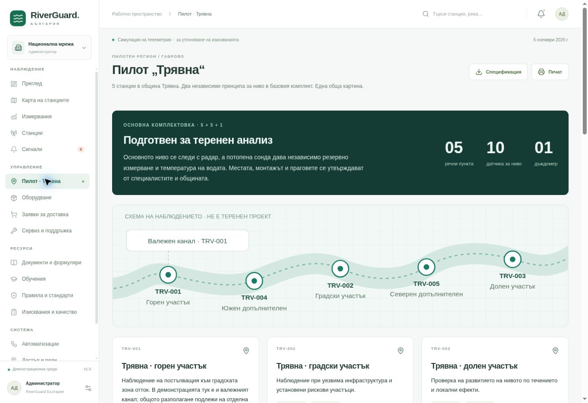
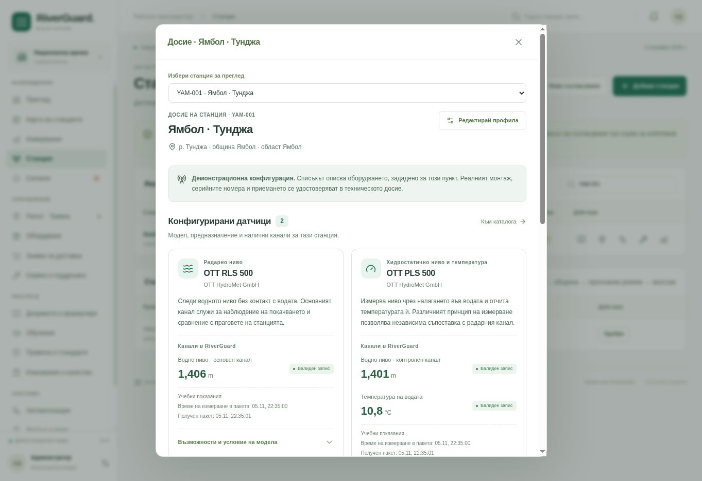
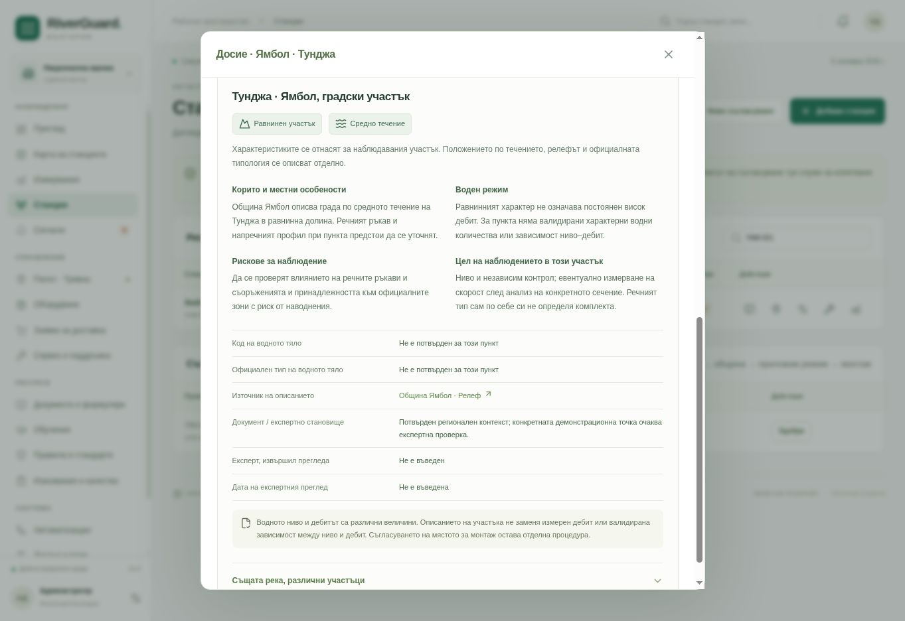

# Досиета на станциите и пилот с пет пункта в Трявна

## Причина за промяната

Досегашният преглед показваше основните измервания, но не обясняваше всички конфигурирани датчици и предназначението им. Общото описание на реката не позволяваше различни характеристики за отделни участъци по нейното течение. Пилотът в Трявна се разширява от три на пет речни станции по допълнението към заданието.

## Промени

- Досие за всяка станция, достъпно от картата и регистъра, с избор на друг пункт за сравнение.
- Всички конфигурирани модели, техният измервателен принцип, предназначение и каталожни възможности; поддържащото и неописаното оборудване са обозначени отделно.
- Получените канали, единиците, качеството и времето на пакета са отделени от продуктовите възможности. Неподдържани канали и дебит без валидиран модел не получават фиктивни стойности.
- Профил на конкретния речен участък: релеф, положение по течението, корито, режим, рискове, цел на наблюдението, водно тяло, типология, източник и експертна проверка.
- Частична редакция със съществуващите общински права и контрол на версиите. Административното потвърждение изисква данни за проверката и изрично действие във формата.
- Обратно съвместимо четене на речните профили, без промяна на SQL схемата или презапис на запазените метаданни. Запазените данни имат предимство пред работните примери.
- При преместване старото потвърждение и непроменените стари характеристики се изчистват; изрично новите характеристики остават работен профил.
- Седем начални работни профила: пет за пилота в Трявна и два по Тунджа; отделно справочно сравнение на планински, полупланински и равнинни участъци.
- Нови TRV-004 „Трявна · южен допълнителен пункт“ и TRV-005 „Трявна · северен допълнителен пункт“, с радарен и хидростатичен датчик, интервали по 60 секунди и предложени места до експертно решение. Началният набор става 26 станции, от които пет в Трявна.
- Еднократно допълване и на съществуваща база, без дубликати и без презапис на записи, версии, членства или измервания. Зает идентификатор се запазва; след успешното допълване изтрит пункт не се възстановява при презареждане.
- Пилотната схема, картите, броячите, инфраструктурата и изтегляната спецификация са съгласувани с петте пункта и комплект 5 RLS + 5 PLS + 1 Pluvio. Валежният канал е към TRV-001; отделна площадка остава условен проектен вариант.
- Изисквания FR-21–FR-24, приемателни сценарии ACC-13–ACC-15 и обновена документация.

## Проверка

- 131 успешни автоматични проверки: 51 API, 71 домейн и 9 за инвентара и каналите; 0 неуспешни, 0 пропуснати.
- 43 нови проверки спрямо първоначалните 88, включително 7 за разширението до пет станции.
- Успешни TypeScript проверка и компилиране.
- Браузърно проверени различни комплекти датчици, речни описания, изрично потвърждение, последващо връщане за преглед, общински обхват и изглед при 390 px.
- Браузърно проверени петте пункта върху картата, досиетата на TRV-004/005, измерванията на TRV-004 и пилотната схема. Изтеглената спецификация съдържа пет станции, пет роли и 5 + 5 + 1 устройства.
- Новият пилотен изглед е проверен при 390 px: страницата няма хоризонтално преливане; широката схема се превърта в собствен контейнер и с клавиатура.
- Автоматичните проверки и браузърният обхват са записани в `lib/quality-report.json`. Съществуващият GitHub Actions workflow изпълнява тестове, типове и компилиране при pull request.

## Преглед

## Граници и внедряване

Промяната използва демонстрационни станции и не удостоверява реален монтаж. Регионалните източници не заменят експертна проверка на точните координати. Подробно са описани седем работни профила; другите станции показват неуточнени характеристики до попълване от отговорния екип. Няма свързан физически хардуер или добавен модел за изчисляване на дебит.

Приемането на кода е чрез pull request. Публикуването на приетата версия на сайта е отделна стъпка след прегледа. Не е нужна промяна на SQL схемата. Вложеният профил се съхранява в съществуващия JSON запис на станцията. Допълването с TRV-004 и TRV-005 се изпълнява веднъж в обща транзакция с маркер за версията; не се преинициализира базата.

## Източници за речните участъци

- РИОСВ–Стара Загора, „Състояние на водите през 2024 г.“, таблица 1-1: типология и граници на участъците по Тунджа.
- Община Ямбол, „Релеф“: средното течение и равнинният контекст на града.
- БД „Източнобеломорски район“, карти за Тунджа по ПУРН 2022–2027: основа за последващо пространствено съпоставяне.

Пълните адреси и границите на приложимост са в `lib/river-sections-content.json` и в самото досие. Проследимостта на изискванията следва използвания в проекта PMBOK, 6. издание, раздел 5.2.3.2.
